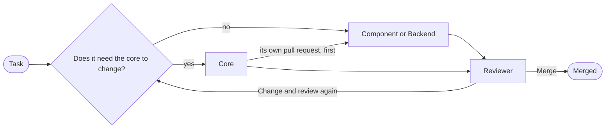

# agents

What someone who changes limn needs and a host does not: how the core is
built, what must always hold, how work is done here, and the role to take for
each kind of task. The rules themselves are in [`AGENTS.md`](../AGENTS.md);
every page here hangs from it.

[`docs/`](../docs/README.md) is the other half: what a host needs to use
limn. A page belongs there if an application's author would read it, and here
if only a contributor would.

## Pages

| Page | Answers |
| --- | --- |
| [Architecture](architecture.md) | What runs in a frame? Where does state live? Which file holds what? What does a frame cost? What was taken from GPUI and WarpUI, and what was not? |
| [Invariants](invariants.md) | What always holds, what checks it, and what a break looks like? |
| [Workflow](workflow.md) | Where do I work, what do I run, how do I write the commit and the pull request, how do I measure? |
| [Plan](plan.md) | What does stable mean, what is done, and what comes next? |

## Roles

One file for each kind of task: what the role is for, what to read first, its
rules, what it delivers and what to check before finishing. A role adds to
`AGENTS.md` and never loosens it.

| Role | Takes | Delivers |
| --- | --- | --- |
| [Core](roles/core.md) | The tree, layout, events, retained state. | The change, its test, numbers when speed is in question, these pages updated. |
| [Component](roles/component.md) | A new control, or an option on one. | The component, its tests, its gallery page, its guide. |
| [Backend](roles/backend.md) | `limn-egui`, and what a frame asks of a backend. | The change, `docs/backend.md` when the contract moved. |
| [Reviewer](roles/reviewer.md) | Any change, before it merges. | Findings and one verdict. |

A task that needs the core and a component is two pull requests: the core's
first.

## Using a role

- **Any assistant:** have it read `AGENTS.md` and the role's file before the
  task.
- **Claude Code:** each role has the front matter of a subagent (`name`,
  `description`). Link or copy the files into `.claude/agents/` to call them
  by name.
- **A person:** the role's "Before finishing" list is the checklist for the
  pull request.

## Keeping these pages true

- A page changes in the pull request that changes what it describes (R19).
- Pages name symbols and files, never line numbers.
- A statement about the code is read from the code; a number is measured,
  with its date (R21).
- [`plan.md`](plan.md) carries the date it was last brought up to date.
