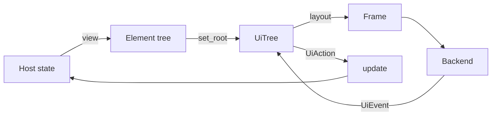

# Architecture

How the core is built: what runs in a frame, where state lives, and which
file holds what. [Concepts](../docs/concepts.md) is the same model from a
host's side; read it first. This page names symbols and files to search for.
It gives no line numbers: they would be wrong within a week.

## The model



Three holders, and what each may keep:

| Holder | Keeps | For how long |
| --- | --- | --- |
| The host | Every value a user can change: a field's text, whether a switch is on. | As long as it likes. |
| `UiTree` | Interaction state: focus, hover, press, carets, scroll offsets, springs on their way. | By the rule of its kind; see [State](#state). |
| `Element` | Nothing. It describes one thing on screen. | One frame: `set_root` drops the last tree. |

A `Frame` is data. Its public part is `commands` (what to paint, in order),
`regions` (pointer targets, bottom to top) and `access` (what the platform is
told). Its private part is what events need from the last layout: slider and
scrollbar geometry, focus scopes, text blocks that can be selected. The tree
keeps the frame, and `layout` returns a clone of it.

## The files of the core

The engine and the design are separate crates, each flat in its `src/`: no
folders. `limn-core` is the engine, in `crates/limn-core/src/`; it never
depends on the design. `limn-components` is the design, in
`crates/limn-components/src/`; it depends on `limn-core` and reaches only what
`limn-core` makes public. `limn` re-exports both under one name.

In `crates/limn-core/src/`:

| File | Holds |
| --- | --- |
| `element.rs` | `Element`, `ElementKind`, `Style`, and the builder methods. An `Element` is at most 704 bytes: `an_element_stays_within_its_size_budget` fails above that, so a rare field goes in `Kept` or behind a `Box`. |
| `tree.rs` | `UiTree` (state and events), `LayoutBuilder` (one layout pass), `Frame`, `HitRegion`, `DrawCommand`, `UiEvent`, `UiAction`, `Key`, and the state of text inputs. |
| `*_tree.rs` | Parts of the layout that have moved out of `tree.rs`: child modules of `tree`, so they reach its private items. `zoom_view_tree.rs`, `horizontal_scroll_tree.rs`, `plot_tree.rs`, `corner_mask_tree.rs`, `context_menu_tree.rs`, `ime_tree.rs`. |
| `state_store.rs` | `StateStore`: what the layout keeps for an element, by its ID and the state's type. |
| `measurement_cache.rs` | `MeasurementCache`: the sizes one layout pass has measured. |
| `text_layout.rs`, `text_layout_cache.rs`, `text_width_cache.rs`, `formatted_text_cache.rs`, `fonts.rs` | Text: shaping and line breaking with parley, and the caches that outlive a frame. |
| `motion.rs` | `ScalarTransition`, `ScalarSpring`, `ColorTransition`, `Easing`: values on their way somewhere. |
| `tokens.rs` | `tokens()`: radii and durations. |
| `access.rs` | `AccessNode`, `Role`: what a frame tells the platform. |
| `components.rs` | The `Component` trait, `ComponentPalette`, `Button` and the first components. |
| every other file | What the engine lays out or opens itself, one file each: the code editor (`code_editor.rs` and its `code_editor_*.rs` modules), `code_diff.rs`, `flowchart.rs`, `sequence.rs`, `spinner.rs`, `context_menu.rs` and more. Also helpers (`geometry.rs`, `labels.rs`, `typography.rs`, `hot.rs`), and two more child modules of `tree`: `inline_menu_navigation.rs` and `captured_paste.rs`. |
| `*_tests.rs` | Tests split out of the file they test. `tree.rs` and its child modules declare theirs with `#[path]`, so those see the tree's private state. The rest are declared with `#[path]` from the file they test. |

In `crates/limn-components/src/`:

| File | Holds |
| --- | --- |
| `theme.rs`, `scheme.rs` | `Theme` and `Scheme`: a window's colors. |
| every other file | Mostly one component each, with its tests in a `#[cfg(test)]` module or a `*_tests.rs` beside it. |
| `*_tests.rs` | Tests split out of the file they test, declared in `lib.rs` or from the component they test. |

Tests that use only the public API are in `crates/limn/tests/`. Two of them
are tables kept by hand: `controls.rs`, which every control that reports an
action joins (one action per click, Enter and Space; reached by Tab; inert
when disabled), and `conventions.rs` (both spellings of disabling, and
numbers that are not numbers).

## A frame, step by step

The host's loop is in [`docs/backend.md`](../docs/backend.md#the-frame-loop):
events, `update`, `set_root(view(state))`, `layout`, paint. Inside
`UiTree::layout_at`:

1. **Begin.** `TextLayoutCache` and `TextWidthCache` start a pass.
2. **Walk for claims.** Before anything is placed, `collect_focus_claims`
   walks the tree for the controls that take focus, in tree order, and for the
   IDs taken twice (`Frame::duplicate_ids`). `collect_action_metadata` gathers
   the aliases of `dispatch_as`. A focus asked for earlier (`pending_focus`)
   lands here if this tree holds its control. A control in a row of a virtual
   list is known only once placed: it takes the focus after step 4. A request
   that no control answers is dropped by this layout.
3. **Place the root.** The `MeasurementCache` is cleared. A `LayoutBuilder`
   borrows the tree's state for the pass and places the root in the viewport.
   See [Measure and place](#measure-and-place).
4. **Place what floats.** Popovers, menus and the context menu are placed
   after the root, so they paint over it and answer the pointer first.
   Tooltips are painted there with no region. The ghost of a dragged element
   is a copy of its commands, appended last.
5. **Sweep.** `StateStore::sweep` forgets what was not touched at this
   layout's instant, and the popover maps drop what has finished leaving.
6. **Answer requests.** Now that each control's place is known, a focus or a
   `reveal` may move a scroll offset; if it does, the pass runs again inside
   the same call. A coach mark's new step, a popover that opens with an
   initial focus, and a pushing reach that jumped while placed
   (`pushes_moved`) always run it again. A `center` only starts the scroll: it
   shows from the next frame.
7. **Reconcile the pointer.** Something may have moved under a pointer that
   did not. If the control under it changed, the pass runs once more so the
   frame paints the hover.
8. **Trim.** `keep_recent_state` forgets the dormant state beyond the most
   recent, and the frame is returned.

So the host calls `layout` once a frame, and the tree may run its pass more
than once inside that call. Each repeat is a whole pass.

## Measure and place

Layout is two functions of `LayoutBuilder` that call each other down the tree.

| | `measure(element, available) -> Size` | `place(element, rect, clip)` |
| --- | --- | --- |
| Takes | `&self` | `&mut self` |
| Does | Says how much room the element wants. | Gives each child its rectangle and writes the frame: commands, regions, access nodes. |
| State | Reads what the last layout left. Changes nothing. | Changes it, through `states_mut!`. |
| Called | By any parent, as often as it needs. | Once a pass for each element laid out, whether it ends up in view or not. |
| Cached | In `MeasurementCache`, for this pass. | No. |

- `measure_uncached` is the `match` on `ElementKind` that measures;
  `place_inner` is the one that places. `place_inner` is about 2,900 lines:
  the largest function in the crate, and where most features meet.
- The key of a measurement is the element's address, the room it was offered
  and a scope. The address is stable because the tree is not changed during a
  pass; the scope tells apart trees built during the pass (a virtual list's
  rows, an overlay) that may reuse an address.
- An element whose size animates is measured from the state the last layout
  left and from `now`. Its measure predicts; its placing computes the same
  value and keeps it: `flow_height` with `keep_flow`, and `next_scalar`. A
  reach that pushes its neighbours is measured where its spring stands, and
  the pass runs again if placing moved it.
- Placing writes paint, hit regions, accessibility and animation state in one
  walk. Nothing is skipped across frames: a pass costs in proportion to the
  whole tree, not to what changed. See [Cost](#cost).

## State

What `UiTree` keeps is of three kinds. A new piece of state belongs to one of
them, and the kind decides where it goes.

| Kind | Where | Lasts |
| --- | --- | --- |
| Per element, while it is shown: a spring, a slot's height, an ink changing color, when a spinner started. | `StateStore`, by ID and by the state's type. | While layouts touch it. The sweep after a pass forgets what was not touched at that layout's instant; a pass that repeats has the same instant. |
| Per control, to outlive its absence: a field's text and caret (`inputs`), a scroll offset (`scroll_offsets`), a measured list's rows, a horizontal scroll. | A map of its own on `UiTree`, stamped in `LastLaidOut`. | While laid out, then for the `DORMANT_KEPT` (64) IDs of its kind laid out most recently. |
| One for the window: the focused ID, the hovered ID, the pointer, the press or drag under way, the open context menu. | A field of `UiTree`. | Until an event or a layout changes it. |

Using the store, inside `LayoutBuilder`:

```rust
struct PulseStart(Instant);                       // a type of its own, even over one value

let mut states = states_mut!(self);               // while placing only
let start = states.touch(id, self.now, || PulseStart(self.now)).0;
drop(states);                                     // before measuring or placing anything else
```

- `touch` finds or makes the state and keeps it through this pass. `keep`
  keeps one that exists. `get` reads without keeping, and is all a measure
  may use.
- One kind is touched outside a layout: `SliderMotion`, by pointer events.
- State that animates is also named in `UiTree::states_animate`, or beside
  its call in `other_animation_repaint_after_at`, or the host is not asked
  for the frames it needs.
- `set_reduced_motion(true)` empties the store when it is called, and the
  layouts after it keep values at rest: nothing in the store may be the only
  record of something the user did.
- The popover family still has maps of its own (`popover_transitions`,
  `popover_snapshots`, `popover_exits`, `popover_view_transitions`): a popover
  outlives its element while it leaves, which the store's sweep does not
  express.
- Other maps by ID that sweep themselves: `scroll_transitions`,
  `scrollbar_states`, `zoom_views`, the code views (`code_editors`,
  `code_diffs`), `tooltip_triggers`, `settled_spinners`,
  `closed_submenu_triggers`, and the sheets' `sheet_detents` and
  `sheet_frames` with the popovers' `popover_order`, which are newer than R3
  and belong in the store.
- `scroll_to_end` and `scroll_to_index` are not swept: a request for an ID
  that is never laid out stays. See [invariant 5](invariants.md#the-table).

## Events

`UiTree::handle_event_at` takes one `UiEvent` and returns the `UiAction`s it
caused.

- An event is resolved against the frame the user saw: the regions of the
  last layout. Nothing is laid out to answer an event.
- `Frame::hit_test` walks `regions` from last to first and takes the first
  that holds the point. One control answers: there is no bubbling and no
  capture phase. Two exceptions are written into `region_at`: a press passes
  through a passive hover target to the control under it, and an overlay
  scrollbar's empty track yields, for hover and press alike, to a button or a
  text field under it. The wheel is the third: the delta a scroll area does
  not use passes to the one around it.
- The action carries the control's ID, or its alias from `dispatch_as`.
- Tab order is the tree order that `collect_focus_claims` found. A popover, a
  tab strip and an inline menu each hold a focus scope, kept in the frame.
- What must wait for a layout is queued. `pending_focus` is answered in
  step 2, or after step 4 for a virtual list's row; `scroll_to_end` and
  `scroll_to_index` when their scroll area is placed; `pending_reveal`,
  `pending_center` and the focused control's own reveal in step 6.

## Text

Two paths, side by side. `UiTree::set_text_layout(true)` moves
`Element::text`, formatted text and text fields to the first; a button's
label, truncated and faded text, shortcuts, tooltips and code views stay on
the second.

| Path | Who measures | Painted as |
| --- | --- | --- |
| limn's own layout (`attach_fonts` in `limn-egui` turns it on, and installs the measurer for the rest) | `text_layout.rs`, with parley, in the faces of `limn::fonts()`. | `DrawCommand::Glyphs`: placed glyphs, nothing left to lay out. |
| Measured text | The host's `set_text_measurer`, or an estimate from `FontMetrics`. | `DrawCommand::Text`: a wrapped run the backend paints with its own font. |

Most tests use the second path with no measurer, so no font is loaded and
widths are the `FontMetrics` estimate. A test that needs exact widths
installs a fixed-width one.

What is kept across frames, and its bound:

| Cache | Keeps | Bound |
| --- | --- | --- |
| `TextWidthCache` | Widths of measured fragments. | Two generations: what the last pass did not read is dropped. |
| `TextLayoutCache` | Shaped layouts. | This pass and the one before. |
| `FormattedTextCache` | Wrapped paragraphs of formatted text. | 2,048 entries and 4 MB. |
| `markdown_cache.rs` | The trees a `Markdown` renders to, while its source, width and colors are the same. | Bounded; see the file. |

The tables read for every element (the state store, the measurement and
width caches, the focus walk's set) hash with foldhash (`FastMap`, `FastSet`
in `limn-core`'s `lib.rs`): SipHash was a third of a long list's layout. The frame's own
maps and the other text caches still use std's.

## Motion and repaint

- A value on its way is a `ScalarTransition` (a duration and an easing) or a
  `ScalarSpring`; a color is a `ColorTransition`. They are read with the
  layout's `now`, not the wall clock, so `layout_at` drives them in tests.
  One exception is known: the code editor's `EditorView::update` reads the
  wall clock when its document changes.
- Durations come from `tokens().motion`. A few are still constants in
  `tree.rs`: a popover's change of view, the effort slider, the delay of a
  tooltip.
- `UiTree::animation_repaint_after` tells the host when the next frame is
  due, and `None` when nothing moves. A host that honors it draws only when
  something changes.
- `set_reduced_motion(true)` settles everything at its end.

## Tokens and colors

`tokens()` returns the tokens of the innermost `with_tokens` on this thread,
else the process's (`set_tokens`). Both `view` and `layout` read them, so a
window with tokens of its own runs both inside `with_tokens`. Colors are
passed, not global: a `ComponentPalette` goes to each component. The one
exception is `Tokens::tooltip`, the colors of every tooltip.

## The backend's side

[`docs/backend.md`](../docs/backend.md) is the contract: every `DrawCommand`,
every `UiEvent`, fonts, and the loop. `limn-egui` is the one backend: `events`
turns egui's input into `UiEvent`s, `paint` carries out a frame, `attach_fonts`
gives the tree the fonts it paints with, `apply_access_requests` brings back
what a screen reader asked for.

Four commands describe a widget, not a shape: `Spinner`, `Record`,
`ProgressRing` and `EffortSlider`. A backend has to know how each looks.
They are debt; see R8 and the [plan](plan.md). `Glass`, `GlassSelection` and
`TextEffect` came with liquid glass and with a host's faces, and have not been
read against R8 yet.

## Cost

`crates/limn/examples/layout_bench.rs` builds and lays out a scroll area of
N rows, each a text, a spacer and a `Button`, in a 1280 by 800 window. On a
Ryzen 9 270, pinned to one core, on 2026-11-10:

| Rows | Building the view | Layout |
| ---: | ---: | ---: |
| 100 | 0.02 ms | 0.14 ms |
| 1,000 | 0.22 ms | 1.15 ms |
| 4,000 | 1.3 ms | 7.8 ms |

- The frame paints 82 commands at every size: only what is in view is
  emitted. The time is the walk, which reaches every element.
- It grows faster than the rows do: four times the rows take seven times as
  long. A profile points at tables that no longer fit the processor's cache
  and at freeing the last tree, but the cause is not settled.
- `UniformList` and the measured list lay out only the rows in view. A list
  of unknown length uses one of them.

[Measuring](workflow.md#measuring) says how to run it so that two runs compare.

## Lineage

limn's core is reviewed against two engines: GPUI, of Zed (`crates/gpui`,
Apache-2.0), and WarpUI, of Warp (`crates/warpui_core` and `crates/warpui`,
MIT). Nothing is copied from either (R20). What follows is what limn shares
with them as an idea, and what it leaves.

| Question | GPUI | WarpUI | limn |
| --- | --- | --- | --- |
| The element tree | Rebuilt every frame; a view can be cached. | Rebuilt for the views that changed. | Rebuilt every frame. |
| State across frames | By element ID and type, in the window. | In handles the view creates and holds. | By ID and type, in the `StateStore`. |
| Forgetting it | What a frame did not ask for dies with the frame. | By hand, in the application. | The sweep after each pass, plus the dormant 64. |
| Identity | The path of IDs from the root. | A global position string. | A flat string the host chooses, also the name in its actions. |
| Phases | Layout, prepaint, paint. | Layout, paint. | One walk: measure inside place. |
| The scene | A few primitives; the renderer knows no widget. | A few primitives in layers. | Primitives, and four widget commands (debt). |
| Who owns the window | GPUI: platform, executor, GPU. | WarpUI. | The host. limn returns data. |
| An ID taken twice | Not detected. | Not detected. | Listed in `Frame::duplicate_ids`. |
| Components with a look | In a crate apart (`ui`); the engine has none. | In a crate apart (`ui_components`). | In a crate apart (`limn-components`); the engine still holds some, see [Known debts](#known-debts). |

Decided, with the reason:

- **IDs stay flat.** A path of IDs, as GPUI's, would scope state by where a
  control sits. In limn the ID is also what the host reads in `UiAction` and
  passes to `focus`: a path would change how every host names its controls.
  `duplicate_ids` and `dispatch_as` cover the mistake a path prevents.
- **The store stamps; it does not swap buffers.** GPUI keeps two frames of
  state and moves what was asked for. limn stamps each entry with the
  layout's clock, because tests lay out twice at one instant and must find
  the same state.
- **No handles for state.** Warp's views create and hold their own state
  handles, and the application clears collections of them by hand. An ID and
  a sweep need no such care.
- **The host keeps the window.** It is why limn runs in a test with no
  display, and why a backend is a separate crate.

## Known debts

Each is in the [plan](plan.md) with its order.

| Debt | Shows as |
| --- | --- |
| `tree.rs` is 24,000 lines and `place_inner` 2,900. | Every feature edits the same file; pull requests conflict. |
| `ElementKind` is closed and holds widgets (`Flowchart`, `SequenceDiagram`, the plots, `Record`, `EffortSlider`). | A widget that could be a component is matched across the layout. |
| Four widget commands in `DrawCommand`. | A backend must know how a widget looks. |
| One walk measures, places, paints and animates. | No subtree can be skipped when nothing in it changed. |
| `UiEvent` grew by case: `PointerDown`, `PointerDownModified`, `PointerDownEditor`. | A new modifier is a new variant. |
| Keys the tree derives are strings (`extend/{id}`, `slide/{id}`), and a region is known as a popover's by its `popover_surface:` prefix. | A host's ID with that prefix would be misread. |
| `layout` returns a clone of the frame. | Not measured on a large screen. |
| The engine still holds design: the controls in `components.rs`, the tooltips, context menu and scrollbars the tree paints itself, the widgets in `ElementKind`, liquid glass and sheets. | An application with a design of its own cannot change them. |
| The design reaches the engine through seams, `#[doc(hidden)] pub`. | Each one is a component a host could not have built. |
